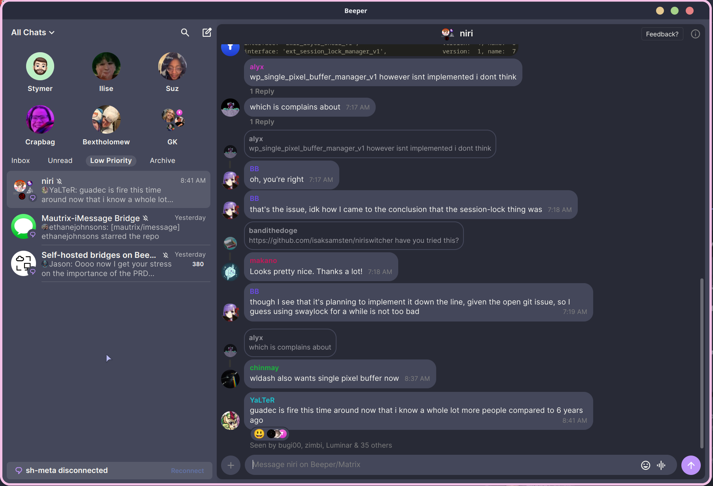

  <h1 style="border-bottom: 0">Beeper Dracula</h1>
  <figure>
    
    <h3 style="margin-top: 0; padding-top: 0">
      Unofficial Dracula theme for
      <a href="https://www.beeper.com">Beeper Desktop</a>
    </h3>
  </figure>
  <figure>
    
     
    <figcaption><b>Preview</b></figcaption>
  </figure>

<h2 align="center">Install</h2>

1. Download the file `custom.css` from this repository.
1. Navigate to your Beeper config folder
	- You can do this either by navigating to your config folder (eg `~/.config/BeeperTexts`) manually, or by going into the settings menu in the Beeper application, navigating to the appearance menu, and clicking "Show CSS File" under the "Custom CSS" header.
1. Replace the existing `custom.css` file with the one downloaded from this repository.
2. Refresh Beeper to see changes in effect (either Ctrl+Alt+Shift+R, or press Ctrl+J to open the command menu and reload from there).
